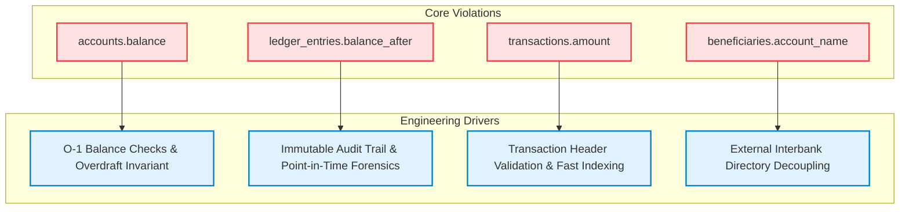

# Normalisation & Deliberate Denormalisation Report

**Course:** MIT 8103 – Advanced Database Systems  
**Institution:** Miva Open University — Master of Information Technology (MIT)  
**Module:** Continuous Assessment (Virtual Lab Portfolio 1)  
**Database:** Carbon / NairaPay Core Banking & Ledger System (`carbon_db`)  
**Author:** Oluwafemi Emmanuel Oluwarotimi ([@Dumeloh](https://github.com/Dumeloh))  

---

## 1. Introduction

In relational database theory, normalisation is the formal process of organising schemas to minimise redundancy and eliminate insertion, update, and deletion anomalies while preserving data integrity. Edgar F. Codd’s normal forms—specifically **First (1NF)**, **Second (2NF)**, **Third (3NF)**, and **Boyce-Codd Normal Form (BCNF)**—provide strict mathematical guarantees regarding functional dependencies ($X \rightarrow Y$).

However, in production enterprise systems—particularly in high-throughput financial technology (fintech) and core banking platforms—**strict adherence to Third Normal Form (3NF) can create catastrophic performance bottlenecks, high-latency query overhead, and loss of point-in-time auditability**. 

This document provides a rigorous theoretical evaluation of the `carbon_db` schema, analyzing its baseline normalisation compliance and formally explaining the **four deliberate 3NF violations** introduced into the physical design:
1. `accounts.balance`
2. `ledger_entries.balance_after`
3. `transactions.amount`
4. `beneficiaries.account_name`

---

## 2. Theoretical Baseline: 1NF to BCNF Compliance

Across non-financial supporting relations (`customers`, `kyc_records`, `cards`, `fraud_flags`), the schema strictly conforms to **Boyce-Codd Normal Form (BCNF)**:

| Relation | Primary / Candidate Keys | Functional Dependencies ($X \rightarrow Y$) | Normal Form Status |
| :--- | :--- | :--- | :---: |
| **`customers`** | `customer_id` (PK)<br>`email` (UK)<br>`phone` (UK) | `customer_id` $\rightarrow$ `{first_name, last_name, email, phone, customer_type, status, created_at}`<br>`email` $\rightarrow$ `{customer_id, ...}`<br>`phone` $\rightarrow$ `{customer_id, ...}` | **BCNF** (All determinants are candidate keys) |
| **`kyc_records`** | `kyc_id` (PK) | `kyc_id` $\rightarrow$ `{customer_id, id_type, id_number, verification_status, submitted_at, verified_at}` | **BCNF** |
| **`cards`** | `card_id` (PK) | `card_id` $\rightarrow$ `{account_id, last_four, card_type, expiry_date, status}` | **BCNF** |
| **`fraud_flags`**| `flag_id` (PK) | `flag_id` $\rightarrow$ `{transaction_id, reason, risk_score, status, flagged_at}` | **BCNF** |

---

## 3. The Engineering Trade-off: Pure Theory vs. Production Banking

Third Normal Form requires that:
1. The relation satisfies 2NF (no partial functional dependencies on any candidate key).
2. **Every non-prime attribute is non-transitively dependent on every candidate key of the relation.** That is, for every functional dependency $X \rightarrow Y$, either:
   - $X$ is a superkey, or
   - $Y$ is a prime attribute (part of a candidate key).

A direct corollary of 3NF is that **derived, aggregate, or transitive attributes must not be persisted**. In pure database theory:
- An account balance is merely the dynamic sum of historical ledger movements.
- A running balance is a transient query projection.
- A transaction amount is an aggregation of its constituent debit and credit legs.
- A counterparty bank account name belongs to the external banking directory, not the user's recipient list.

While pure 3NF eliminates storage redundancy, in high-frequency payment gateways it causes:
- **Massive $O(N)$ Read Latency:** Calculating a balance requires scanning and aggregating millions of ledger entries per query.
- **Excessive Lock Contention:** Validating that a balance cannot go below zero (`balance >= 0`) during concurrent transfers would require locking the entire ledger history for an account.
- **Loss of Point-in-Time Forensic Immutability:** Historical statements cannot rely on dynamic recalculations if historical exchange rates, corrections, or retroactive entries occur.

To solve these critical engineering problems, the `carbon_db` architecture introduces four deliberate, controlled denormalisations.

---

## 4. In-Depth Analysis of Deliberate 3NF Violations



---

### 4.1 Violation 1: `accounts.balance`

#### A. Formal 3NF Violation Proof
In a true double-entry bookkeeping model, an account balance is an aggregate computed value:

$$\text{balance} = \sum (\text{CREDIT amounts}) - \sum (\text{DEBIT amounts})$$

The dependency in the relation `accounts(account_id, customer_id, account_number, currency, balance, status, opened_at)` is:

$$\text{ledger\_entries(account\_id)} \rightarrow \text{accounts.balance}$$

Because `balance` transitively depends on the set of historical rows in `ledger_entries` rather than strictly on `account_id` as an atomic primitive fact, storing `balance` in `accounts` introduces a **transitive / derived attribute dependency**, violating 3NF.

#### B. Theoretical Anomaly Risks
- **Update Anomaly:** If a new row is appended to `ledger_entries` but `accounts.balance` is not updated (or vice versa), the cached balance drifts from the true ledger sum.
- **Inconsistency Risk:** A software crash during partial execution could leave the cached balance out of sync with the audit log.

#### C. Engineering Rationale & Justification
1. **$O(1)$ Balance Lookups:** A retail fintech platform handles thousands of balance checks per second (mobile dashboard views, debit card POS authorisations, ATM queries). Performing an aggregation (`SELECT SUM(...) FROM ledger_entries WHERE account_id = ?`) across an account with 50,000 transactions would cause disk I/O spikes, cache thrashing, and unacceptable p99 latency (> 500ms). The denormalised column enables instant index lookups in $< 1\text{ms}$.
2. **Atomic Overdraft Prevention via DDL Check Constraints:**
   ```sql
   CHECK (balance >= 0)
   ```
   PostgreSQL enforces `CHECK` constraints on row modifications. Storing `balance` directly on `accounts` allows PostgreSQL to evaluate `balance >= 0` instantaneously during `UPDATE accounts SET balance = balance - 1000`. If the balance would drop below zero, the database engine aborts the transaction immediately with a `check_violation` exception without needing table-level locks on `ledger_entries`.

#### D. Integrity Safeguards
- In production, updates to `accounts.balance` and insertions into `ledger_entries` are always wrapped in a single atomic database transaction (`BEGIN ... COMMIT`) utilizing pessimistic row-level locking (`SELECT balance FROM accounts WHERE account_id = ? FOR UPDATE`).
- Nightly reconciliation batch jobs compute `SUM(ledger_entries)` and verify zero variance against `accounts.balance`.

---

### 4.2 Violation 2: `ledger_entries.balance_after`

#### A. Formal 3NF Violation Proof
The relation `ledger_entries(entry_id, transaction_id, account_id, direction, amount, balance_after, created_at)` contains the running balance immediately following the posting of the line.

The value of `balance_after` is functionally determined by the prior ledger entry's running balance plus or minus the current `amount`:

$$\text{balance\_after}_i = \text{balance\_after}_{i-1} \pm \text{amount}_i$$

Because `balance_after` is derived from prior entries in the relation and the current line's `amount`, it is a **transitive / calculated dependency**, violating 3NF.

#### B. Theoretical Anomaly Risks
- **Redundancy:** The same mathematical state is encoded multiple times across successive ledger rows.
- **Cascade Corruption:** In a traditional editable relation, updating entry $i$ would require updating `balance_after` on all subsequent entries $i+1, i+2, \dots, n$.

#### C. Engineering Rationale & Justification
1. **Immutable Point-in-Time Forensic Auditability:** In financial accounting, **the ledger is strictly append-only**—rows are *never* updated or deleted. By storing `balance_after` on each immutable entry, the database preserves the exact financial state of the customer's wallet at that exact microsecond.
2. **Constant-Time Dispute & Statement Generation:** Generating a historical account statement (e.g., "What was the balance on March 15th at 14:02?") requires reading a single row (`balance_after`) instead of reconstructing historical state by aggregating all transactions from the inception of the account up to that timestamp.
3. **Ledger Integrity Auditing:** Auditing algorithms can mathematically verify chain integrity in $O(N)$ sequential time simply by verifying that:
   $$\text{balance\_after}_k - \text{balance\_after}_{k-1} = \pm \text{amount}_k$$
   Any tampering or missing ledger line is detected immediately without external reference data.

#### D. Integrity Safeguards
- Enforced with `CHECK (balance_after >= 0)`.
- Ledger rows are write-once, read-many (WORM). Permissions restrict `UPDATE` and `DELETE` privileges on `ledger_entries` in production.

---

### 4.3 Violation 3: `transactions.amount`

#### A. Formal 3NF Violation Proof
In a pure double-entry relational model, money movements exist exclusively in the balanced journal lines (`ledger_entries`). A `transaction` is merely an orchestration header that groups together balanced debits and credits:

$$\text{transactions.amount} = \sum_{\text{direction} = \text{'CREDIT'}} \text{ledger\_entries.amount}$$

The functional dependency is:

$$\text{ledger\_entries(transaction\_id, direction)} \rightarrow \text{transactions.amount}$$

Storing `amount` on `transactions` creates redundant data between `transactions` and `ledger_entries`, representing a **derived transitive dependency** that violates 3NF.

#### B. Theoretical Anomaly Risks
- **Discrepancy Anomaly:** The sum of `ledger_entries.amount` for a transaction could theoretically disagree with `transactions.amount` if not coordinated within the same transaction.

#### C. Engineering Rationale & Justification
1. **Header-Level Invariant Validation:** Before debiting or crediting accounts, the transaction record is created with its business intent. The constraint:
   ```sql
   CHECK (amount > 0)
   ```
   ensures invalid (zero or negative) amounts are rejected before ledger orchestration begins.
2. **Query Ergonomics & Analytical Performance:** In 95% of customer queries (e.g., viewing transaction history in a mobile app, transaction lists, fraud risk scoring, SMS alerts), users query transaction metadata (`initiated_at`, `txn_type`, `status`, `amount`). If `amount` were omitted from `transactions`, every single query would require a `JOIN` to `ledger_entries` with an aggregation filter (`WHERE direction = 'CREDIT'`). This would increase query complexity and double execution cost on high-volume analytical workloads.
3. **Idempotency Recheck:** When client retries occur with the same `idempotency_key`, the engine can inspect the existing transaction's `amount` and status directly from the indexed `transactions` table in $O(1)$ time without traversing child ledger lines.

#### D. Integrity Safeguards
- Composite uniqueness on `ledger_entries(transaction_id, account_id, direction)` guarantees ledger line atomicity.
- Double-entry posting services enforce that $\sum \text{Debits} = \sum \text{Credits} = \text{transactions.amount}$.

---

### 4.4 Violation 4: `beneficiaries.account_name`

#### A. Formal 3NF Violation Proof
In the relation `beneficiaries(beneficiary_id, customer_id, bank_name, account_number, account_name)`:
- The candidate key is `beneficiary_id` (and composite candidate key `(customer_id, bank_name, account_number)`).
- In a closed banking universe, an account number and bank code uniquely identify an account owner:

$$\{\text{bank\_name}, \text{account\_number}\} \rightarrow \text{account\_name}$$

Because `account_name` depends on a subset of the candidate key determinants ($\{\text{bank\_name}, \text{account\_number}\}$) rather than strictly the primary key in relation to the customer, storing `account_name` in `beneficiaries` creates a **transitive/external functional dependency**, violating 3NF.

#### B. Theoretical Anomaly Risks
- **Redundancy Across Customers:** If 100 different customers save the same electricity distribution company or landlord account number, `account_name` is duplicated 100 times.
- **Update Anomaly:** If the beneficiary changes their legal name at their bank, the saved name in `beneficiaries` remains the old name unless updated across every customer's beneficiary list.

#### C. Engineering Rationale & Justification
1. **Cross-Institutional Boundary & Third-Party Decoupling:** In real-world banking (e.g., NIBSS Instant Payment network in Nigeria), beneficiary accounts reside across dozens of external commercial banks (Zenith, GTBank, Access, etc.). The local database **does not own or host the external bank's account tables**. Normalising `account_name` into an internal `bank_accounts` table is impossible because external banks do not expose their customer tables to third parties.
2. **Elimination of Synchronous Interbank API Calls:** If `account_name` were not stored locally, every time a customer opened their "Saved Beneficiaries" screen in their mobile app, the system would need to fire 20+ synchronous Name Enquiry API calls to external banking switches. This would cause severe latency, API rate limiting, and interface failure whenever a third-party bank's lookup switch is offline.
3. **Intent Preservation & Fraud Defense:** Storing the snapshot of `account_name` at the moment the customer confirmed the beneficiary captures the customer's *explicit intent*. If the external account changes ownership later, having the originally approved name provides vital forensic evidence for fraud investigation and dispute resolution.

#### D. Integrity Safeguards
- The multi-column uniqueness constraint:
  ```sql
  UNIQUE (customer_id, bank_name, account_number)
  ```
  prevents a customer from accidentally adding multiple inconsistent alias rows for the identical destination account.

---

## 5. Comparative Normalisation Matrix

| Column / Attribute | Table | Pure 3NF / BCNF Representation | Implemented Denormalised Design | Normal Form Broken | Primary Engineering Justification |
| :--- | :--- | :--- | :--- | :---: | :--- |
| **`balance`** | `accounts` | Dynamic aggregate: `SUM(ledger_entries)` | Stored `NUMERIC(19,4)` column | **3NF** (Transitive / Derived) | $O(1)$ read latency; instant non-negative invariant enforcement via `CHECK (balance >= 0)`. |
| **`balance_after`** | `ledger_entries` | Computed on-the-fly via window functions: `SUM(...) OVER (...)` | Stored `NUMERIC(19,4)` snapshot per entry | **3NF** (Derived / Calculated) | Immutable point-in-time forensic auditing; eliminates full-history reconstruction for statements. |
| **`amount`** | `transactions` | Aggregation of child lines: `SUM(ledger_entries.amount)` | Stored `NUMERIC(19,4)` column on transaction header | **3NF** (Derived / Redundant) | Fast check constraint validation (`amount > 0`); high-throughput filtering without child table joins. |
| **`account_name`** | `beneficiaries` | Separate external relation: `external_accounts(bank, acct_no, name)` | Stored `VARCHAR(150)` snapshot on recipient line | **3NF** (Transitive / External) | Decoupling from external bank APIs; eliminates network latency on beneficiary lookups; preserves audit intent. |

---

## 6. How Integrity is Preserved in the Absence of Pure 3NF

When an engineering architecture intentionally relaxes 3NF, the risk of data divergence must be mitigated through database-level constraints, transactions, and isolation guarantees:

1. **ACID Transaction Boundaries:**
   Updates to `accounts.balance` and insertions into `ledger_entries` never occur in isolation. They are executed within an atomic transaction (`BEGIN ... COMMIT`) under `READ COMMITTED` or `REPEATABLE READ` isolation levels with row-level locks (`FOR UPDATE`).
2. **Database Engine Invariants:**
   PostgreSQL enforces business rules at the storage engine level rather than trusting application code:
   - `accounts.balance >= 0` ensures uncommitted or overdrafting balance updates are rejected immediately.
   - `transactions.amount > 0` ensures zero-sum transfers cannot enter the ledger.
   - `(txn_type = 'REVERSAL') = (reversal_of IS NOT NULL)` ensures reversal amounts strictly correlate with prior operations.
3. **Append-Only Ledger Discipline:**
   `ledger_entries` has no update path in business workflows. Because historical entries are immutable, `balance_after` is immune to retrospective update cascades.
4. **Reconciliation & Auditing:**
   The presence of both `accounts.balance` and `ledger_entries` creates an internal double-check mechanism. Automated reconciliations detect any divergence:

   ```sql
   -- Periodic sanity audit query: verify zero drift between ledger and cached balance
   SELECT 
       a.account_id,
       a.account_number,
       a.balance AS cached_balance,
       COALESCE(SUM(CASE WHEN l.direction = 'CREDIT' THEN l.amount ELSE -l.amount END), 0) AS calculated_ledger_balance,
       (a.balance - COALESCE(SUM(CASE WHEN l.direction = 'CREDIT' THEN l.amount ELSE -l.amount END), 0)) AS variance
   FROM accounts a
   LEFT JOIN ledger_entries l ON a.account_id = l.account_id
   GROUP BY a.account_id, a.account_number, a.balance
   HAVING a.balance <> COALESCE(SUM(CASE WHEN l.direction = 'CREDIT' THEN l.amount ELSE -l.amount END), 0);
   ```

---

## 7. Conclusion

In academic database theory, normalisation up to BCNF represents the ideal state for general-purpose schemas. However, in mission-critical banking and fintech infrastructure, **uncompromising 3NF orthodoxy leads to unsustainable latency, locking overhead, and external dependency failure**.

The `carbon_db` database design achieves an optimal balance: it strictly normalises entity attributes across `customers`, `kyc_records`, `cards`, and `fraud_flags` to BCNF, while selectively and deliberately denormalising `accounts.balance`, `ledger_entries.balance_after`, `transactions.amount`, and `beneficiaries.account_name`. Each violation is backed by clear mathematical trade-offs, fortified by strict DDL constraints, and guarded by double-entry transactional invariants.
