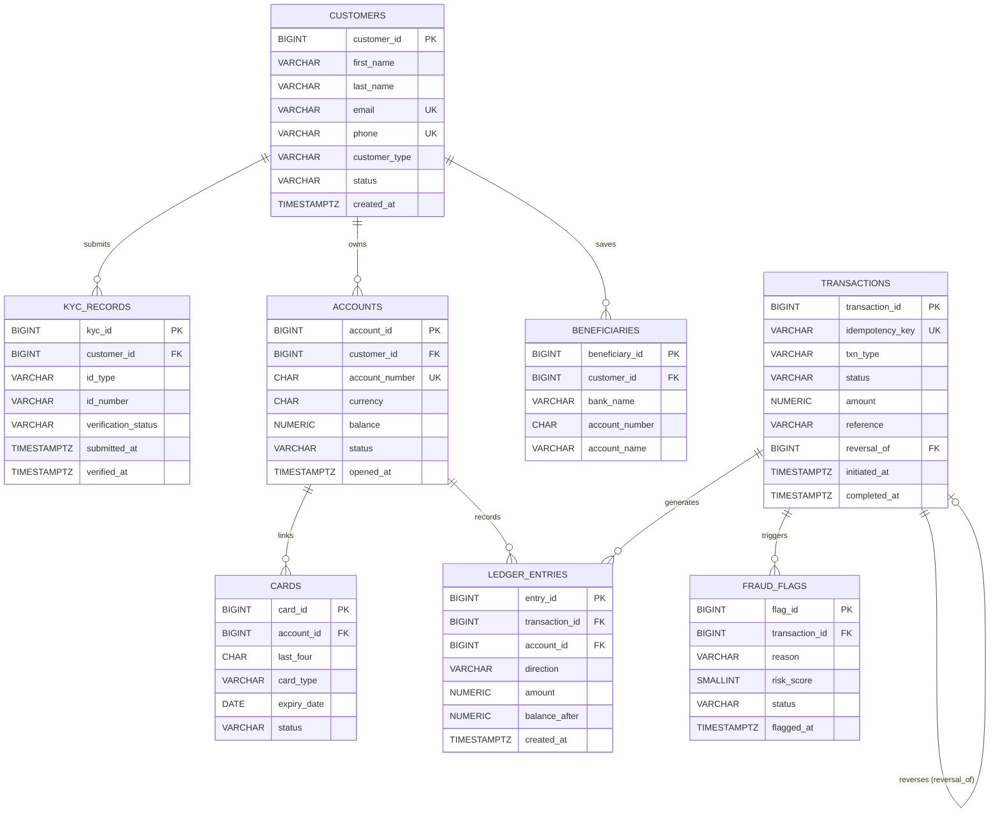
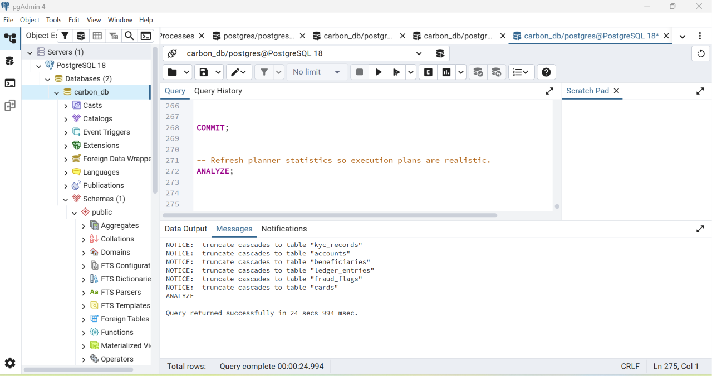

# Portfolio 1: Relational Database Design & Schema Architecture

**Course:** MIT 8103 – Advanced Database Systems  
**Institution:** Miva Open University — Master of Information Technology (MIT)  
**Assessment:** Continuous Assessment (Virtual Lab Portfolio 1)  
**System:** Carbon / NairaPay Core Fintech Ledger System (`carbon_db`)  
**Database Engine:** PostgreSQL 18 | **Management Tool:** pgAdmin 4  
**Author:** Oluwafemi Emmanuel Oluwarotimi ([@Dumeloh](https://github.com/Dumeloh))  

---

## 1. Executive Summary

Portfolio 1 implements a production-grade, highly normalized relational database schema for **Carbon / NairaPay**, an enterprise financial technology (fintech) digital banking and ledger application. In high-velocity transaction systems, data integrity, regulatory compliance, and auditability cannot be compromised. The system enforces strict financial invariants:

- **Double-Entry Bookkeeping:** Every financial movement generates immutable debit and credit ledger entries, guaranteeing that money is neither created nor destroyed arbitrarily.
- **Strict Referential Integrity:** Financial ledgers and customer records prevent destructive deletion cascades (`ON DELETE RESTRICT`) to preserve forensic audit trails.
- **Idempotency Enforcement:** Network retries and duplicate API submissions are deduplicated via unique idempotency keys at the database level.
- **Regulatory & Privacy Safeguards:** Strict adherence to the Nigeria Data Protection Act 2023 (NDPA) and PCI-DSS best practices—storing only truncated card tokens (last four digits) and maintaining distinct, versioned KYC identity records.
- **Exact Numeric Representation:** All monetary balances and transaction amounts use high-precision fixed-point numbers (`NUMERIC(19,4)`), eliminating floating-point IEEE 754 rounding inaccuracies.

---

## 2. System Architecture & Entity-Relationship Model

The relational architecture comprises 8 core entities designed to separate concerns between customer profile management, compliance, payment instruments, transactions, double-entry ledgers, and fraud monitoring.

### 2.1 Entity-Relationship Diagram (ERD)



### 2.2 Visual Schema Architecture (DBML & Graphical ERD)

In addition to standard ANSI SQL DDL, the complete relational schema is authored in **Database Markup Language (DBML)** in [`carbon.dbml`](./carbon.dbml). This provides an interactive, tool-agnostic data definition that can be rendered directly in web visualization tools like [dbdiagram.io](https://dbdiagram.io) and [dbdocs.io](https://dbdocs.io).


*Figure 1: Complete Relational Entity-Relationship Diagram generated via dbdiagram.io from `carbon.dbml`.*

---

## 3. Data Dictionary & Relational Schema

### 3.1 `customers`
Stores identity and status for individual users and merchants.
* **`customer_id`**: `BIGINT GENERATED ALWAYS AS IDENTITY PRIMARY KEY` — Unique synthetic customer identifier.
* **`first_name`**, **`last_name`**: `VARCHAR(100) NOT NULL` — Legal name.
* **`email`**: `VARCHAR(255) NOT NULL UNIQUE` — Primary communication and authentication identifier.
* **`phone`**: `VARCHAR(20) NOT NULL UNIQUE` — MSISDN telephone number.
* **`customer_type`**: `VARCHAR(20) NOT NULL CHECK (customer_type IN ('INDIVIDUAL', 'MERCHANT'))` — Account classification.
* **`status`**: `VARCHAR(20) NOT NULL DEFAULT 'ACTIVE' CHECK (status IN ('ACTIVE', 'SUSPENDED', 'CLOSED'))` — Operational status.
* **`created_at`**: `TIMESTAMPTZ NOT NULL DEFAULT now()` — Account onboarding timestamp.

### 3.2 `kyc_records`
Manages customer Know Your Customer (KYC) identity verification documents.
* **`kyc_id`**: `BIGINT GENERATED ALWAYS AS IDENTITY PRIMARY KEY`.
* **`customer_id`**: `BIGINT NOT NULL REFERENCES customers (customer_id) ON DELETE RESTRICT` — Ensures customer cannot be removed if KYC records exist.
* **`id_type`**: `VARCHAR(30) NOT NULL CHECK (id_type IN ('NIN', 'BVN', 'PASSPORT', 'DRIVERS_LICENCE'))` — Government ID classification.
* **`id_number`**: `VARCHAR(50) NOT NULL` — Official identification string.
* **`verification_status`**: `VARCHAR(20) NOT NULL DEFAULT 'PENDING' CHECK (verification_status IN ('PENDING', 'VERIFIED', 'REJECTED'))`.
* **`submitted_at`**: `TIMESTAMPTZ NOT NULL DEFAULT now()`.
* **`verified_at`**: `TIMESTAMPTZ`.
* **Integrity Constraint:** `CHECK (verified_at IS NULL OR verification_status <> 'PENDING')` — A record cannot have an approval timestamp while remaining pending.

### 3.3 `accounts`
Represents Naira-denominated digital wallets.
* **`account_id`**: `BIGINT GENERATED ALWAYS AS IDENTITY PRIMARY KEY`.
* **`customer_id`**: `BIGINT NOT NULL REFERENCES customers (customer_id) ON DELETE RESTRICT`.
* **`account_number`**: `CHAR(10) NOT NULL UNIQUE CHECK (account_number ~ '^[0-9]{10}$')` — Enforces exact 10-digit Nigerian Uniform Bank Account Number (NUBAN) structure.
* **`currency`**: `CHAR(3) NOT NULL DEFAULT 'NGN'` — ISO-4217 currency code.
* **`balance`**: `NUMERIC(19,4) NOT NULL DEFAULT 0 CHECK (balance >= 0)` — Cached balance with non-negative invariant.
* **`status`**: `VARCHAR(20) NOT NULL DEFAULT 'ACTIVE' CHECK (status IN ('ACTIVE', 'FROZEN', 'CLOSED'))`.
* **`opened_at`**: `TIMESTAMPTZ NOT NULL DEFAULT now()`.

### 3.4 `beneficiaries`
Frequent transfer recipients saved by customers for quick payment dispatch.
* **`beneficiary_id`**: `BIGINT GENERATED ALWAYS AS IDENTITY PRIMARY KEY`.
* **`customer_id`**: `BIGINT NOT NULL REFERENCES customers (customer_id) ON DELETE CASCADE` — Safe cascading deletion since beneficiary lists are convenience data.
* **`bank_name`**: `VARCHAR(100) NOT NULL`.
* **`account_number`**: `CHAR(10) NOT NULL CHECK (account_number ~ '^[0-9]{10}$')`.
* **`account_name`**: `VARCHAR(150) NOT NULL`.
* **Integrity Constraint:** `UNIQUE (customer_id, bank_name, account_number)` — Precludes duplicate entries for identical recipient destinations.

### 3.5 `cards`
Debit and virtual card instruments mapped to wallets.
* **`card_id`**: `BIGINT GENERATED ALWAYS AS IDENTITY PRIMARY KEY`.
* **`account_id`**: `BIGINT NOT NULL REFERENCES accounts (account_id) ON DELETE RESTRICT`.
* **`last_four`**: `CHAR(4) NOT NULL CHECK (last_four ~ '^[0-9]{4}$')` — PCI-DSS compliant tokenization; full Primary Account Number (PAN) is never persisted.
* **`card_type`**: `VARCHAR(20) NOT NULL CHECK (card_type IN ('DEBIT', 'VIRTUAL'))`.
* **`expiry_date`**: `DATE NOT NULL`.
* **`status`**: `VARCHAR(20) NOT NULL DEFAULT 'ACTIVE' CHECK (status IN ('ACTIVE', 'BLOCKED', 'EXPIRED'))`.

### 3.6 `transactions`
Business financial events with idempotency tracking and immutable reversal references.
* **`transaction_id`**: `BIGINT GENERATED ALWAYS AS IDENTITY PRIMARY KEY`.
* **`idempotency_key`**: `VARCHAR(64) NOT NULL UNIQUE` — Cryptographic or UUID token preventing duplicate execution of retried requests.
* **`txn_type`**: `VARCHAR(20) NOT NULL CHECK (txn_type IN ('DEPOSIT', 'WITHDRAWAL', 'TRANSFER', 'BILL_PAYMENT', 'REVERSAL'))`.
* **`status`**: `VARCHAR(20) NOT NULL DEFAULT 'PENDING' CHECK (status IN ('PENDING', 'COMPLETED', 'FAILED', 'REVERSED'))`.
* **`amount`**: `NUMERIC(19,4) NOT NULL CHECK (amount > 0)` — Strictly positive magnitude.
* **`reference`**: `VARCHAR(100)` — External payment gateway reference or memo.
* **`reversal_of`**: `BIGINT REFERENCES transactions (transaction_id) ON DELETE RESTRICT` — Self-referential pointer.
* **Integrity Constraint:** `CHECK ((txn_type = 'REVERSAL') = (reversal_of IS NOT NULL))` — Enforces that a transaction is a `REVERSAL` if and only if it links to an original transaction.

### 3.7 `ledger_entries`
Double-entry bookkeeping journal lines; resolves the Many-to-Many ($M:N$) relationship between `accounts` and `transactions`.
* **`entry_id`**: `BIGINT GENERATED ALWAYS AS IDENTITY PRIMARY KEY`.
* **`transaction_id`**: `BIGINT NOT NULL REFERENCES transactions (transaction_id) ON DELETE RESTRICT`.
* **`account_id`**: `BIGINT NOT NULL REFERENCES accounts (account_id) ON DELETE RESTRICT`.
* **`direction`**: `VARCHAR(6) NOT NULL CHECK (direction IN ('DEBIT', 'CREDIT'))`.
* **`amount`**: `NUMERIC(19,4) NOT NULL CHECK (amount > 0)`.
* **`balance_after`**: `NUMERIC(19,4) NOT NULL CHECK (balance_after >= 0)` — Snapshot balance following line application.
* **Integrity Constraint:** `UNIQUE (transaction_id, account_id, direction)` — Restricts duplicate lines per account per movement.

### 3.8 `fraud_flags`
Risk engine scoring and Anti-Money Laundering (AML) audit log.
* **`flag_id`**: `BIGINT GENERATED ALWAYS AS IDENTITY PRIMARY KEY`.
* **`transaction_id`**: `BIGINT NOT NULL REFERENCES transactions (transaction_id) ON DELETE RESTRICT`.
* **`reason`**: `VARCHAR(200) NOT NULL` — Risk rationale (e.g., velocity anomaly, unusual geolocation).
* **`risk_score`**: `SMALLINT NOT NULL CHECK (risk_score BETWEEN 0 AND 100)` — Normalized risk probability.
* **`status`**: `VARCHAR(20) NOT NULL DEFAULT 'OPEN' CHECK (status IN ('OPEN', 'UNDER_REVIEW', 'CLEARED', 'CONFIRMED'))`.
* **`flagged_at`**: `TIMESTAMPTZ NOT NULL DEFAULT now()`.

---

## 4. Normalization Analysis & Pragmatic 3NF Trade-offs

The schema strictly satisfies normal form criteria up to **Boyce-Codd Normal Form (BCNF)** across all supporting relations (`customers`, `kyc_records`, `cards`, `fraud_flags`). However, in core financial relations, **the design deliberately breaks Third Normal Form (3NF) in four specific locations** to satisfy real-world low-latency OLTP requirements, $O(1)$ overdraft prevention, and immutable point-in-time auditing.

> [!NOTE]
> For a rigorous mathematical and architectural breakdown of these deliberate trade-offs, refer to the dedicated **[Normalisation Report (normalisation.md)](./normalisation.md)**.

| Normal Form | Formal Requirement | Schema Implementation & Justification |
| :--- | :--- | :--- |
| **1NF** (First Normal Form) | - Atomic attribute values (no multi-valued attributes or repeating groups).<br>- Distinct primary key for every relation. | - Every attribute contains a scalar data type.<br>- Repeated contacts or IDs are modeled into separate normalized relations (`kyc_records`, `beneficiaries`).<br>- Synthetic identity primary keys uniquely identify each row. |
| **2NF** (Second Normal Form) | - Satisfies 1NF.<br>- No partial functional dependencies (all non-key attributes fully functionally dependent on the entire candidate key). | - Single-column synthetic primary keys (`BIGINT GENERATED ALWAYS AS IDENTITY`) ensure partial functional dependencies cannot exist.<br>- In composite unique candidate keys like `(customer_id, bank_name, account_number)` in `beneficiaries` and `(transaction_id, account_id, direction)` in `ledger_entries`, every non-key attribute depends on the full composite key. |
| **3NF** (Third Normal Form) | - Satisfies 2NF.<br>- No transitive functional dependencies ($X \rightarrow Y$ where $Y \rightarrow Z$). | - Non-key attributes depend *only* on the primary key.<br>- **Deliberate 3NF Pragmatic Exceptions:**<br>  1. `accounts.balance` (cached aggregate of ledger entries)<br>  2. `ledger_entries.balance_after` (point-in-time running balance snapshot)<br>  3. `transactions.amount` (transaction header amount redundant with ledger lines)<br>  4. `beneficiaries.account_name` (decoupled from external interbank directories) |
| **BCNF** (Boyce-Codd Normal Form) | - For every non-trivial functional dependency $X \rightarrow Y$, $X$ must be a superkey. | - All determinants in non-financial relations are candidate keys or superkeys.<br>- Enforces zero redundancy and eliminates insertion, update, and deletion anomalies. |

---

## 5. Constraint Design & Data Integrity Matrix

| Category | Constraint Name | Affected Table(s) | Description / Invariant Enforced |
| :--- | :--- | :--- | :--- |
| **Entity Integrity** | Primary Keys | All Tables | Synthetic identity columns guarantee row uniqueness and fast indexing. |
| **Domain Integrity** | `balance >= 0` | `accounts`, `ledger_entries` | Eliminates illegal overdrafts or negative wallet balances. |
| **Domain Integrity** | `amount > 0` | `transactions`, `ledger_entries` | Disallows negative or zero-value financial movements. |
| **Pattern Integrity** | `account_number ~ '^[0-9]{10}$'` | `accounts`, `beneficiaries` | Validates compliant 10-digit NUBAN numbers via POSIX regex. |
| **Pattern Integrity** | `last_four ~ '^[0-9]{4}$'` | `cards` | Enforces exact 4-digit card tokens. |
| **Value Domain** | `IN (...)` checks | Multiple Tables | Constrains states (`status`, `customer_type`, `id_type`, `direction`). |
| **Referential Integrity** | `ON DELETE RESTRICT` | `kyc_records`, `accounts`, `cards`, `ledger_entries`, `fraud_flags` | Prevents cascading deletion of audited financial and customer histories. |
| **Referential Integrity** | `ON DELETE CASCADE` | `beneficiaries` | Cleans up non-financial recipient address books when a customer is removed. |
| **Semantic Integrity** | Conditional Verification | `kyc_records` | Ensures `verified_at` can only be set if `verification_status <> 'PENDING'`. |
| **Semantic Integrity** | Symmetric Reversal | `transactions` | Asserts `txn_type = 'REVERSAL'` if and only if `reversal_of IS NOT NULL`. |
| **Uniqueness** | Idempotency Key | `transactions` | Guarantees identical payment requests from client retries cannot be applied twice. |
| **Uniqueness** | Composite Ledger Line | `ledger_entries` | Prevents duplicate debit or credit entries per account in a single transaction. |

---

## 6. Automated Constraint Testing Suite (`03_constraint_tests.sql`)

The repository includes a comprehensive negative-testing test harness executed in PL/pgSQL using anonymous code blocks (`DO $$ ... BEGIN ... EXCEPTION ... END $$;`). Each test attempts an illegal operation and verifies that the database raises the appropriate integrity exception.

```sql
-- Sample test structure verifying that negative balances are blocked
DO $$
BEGIN
    INSERT INTO accounts (customer_id, account_number, balance)
    SELECT customer_id, '0123456780', -1 FROM customers WHERE email = 'ada@example.com';
    RAISE EXCEPTION 'TEST FAILED: negative balance was accepted';
EXCEPTION WHEN check_violation THEN
    RAISE NOTICE 'PASS 1: negative balance rejected';
END $$;
```

### Test Suite Execution Matrix

| Test ID | Constraint Under Test | Target Table | Tested Violation | Expected Outcome |
| :---: | :--- | :--- | :--- | :--- |
| **Test 1** | `CHECK (balance >= 0)` | `accounts` | Inserting account with balance = -1 | `PASS 1: negative balance rejected` |
| **Test 2** | `CHECK (account_number ~ '^[0-9]{10}$')` | `accounts` | Inserting invalid account number `'12AB'` | `PASS 2: malformed account number rejected` |
| **Test 3** | `CHECK (amount > 0)` | `transactions` | Inserting transaction with amount = 0 | `PASS 3: zero-amount transaction rejected` |
| **Test 4** | `CHECK ((txn_type = 'REVERSAL') = (reversal_of IS NOT NULL))` | `transactions` | Inserting `REVERSAL` without `reversal_of` FK | `PASS 4: reversal without original rejected` |
| **Test 5** | `UNIQUE (email)` | `customers` | Inserting duplicate customer email | `PASS 5: duplicate email rejected` |
| **Test 6** | `UNIQUE (idempotency_key)` | `transactions` | Re-executing transaction with identical key | `PASS 6: repeated idempotency key rejected` |
| **Test 7** | `FOREIGN KEY (customer_id)` | `accounts` | Creating account for non-existent customer `999999` | `PASS 7: account for unknown customer rejected` |
| **Test 8** | `ON DELETE RESTRICT` | `customers` | Deleting customer who has open accounts/records | `PASS 8: deleting a customer with accounts is blocked` |
| **Test 9** | `CHECK (risk_score BETWEEN 0 AND 100)` | `fraud_flags` | Assigning risk score of 150 | `PASS 9: out-of-range risk score rejected` |
| **Test 10** | `UNIQUE (transaction_id, account_id, direction)` | `ledger_entries` | Inserting two `CREDIT` lines for same account in one txn | `PASS 10: duplicate ledger line rejected` |

---

## 7. High-Volume Synthetic Data Generation (`04_seed_data.sql`)

To evaluate schema behavior under realistic production volumes and prepare baseline datasets for query optimization (Portfolio 2) and concurrency tests (Portfolio 3), [`04_seed_data.sql`](./04_seed_data.sql) executes a deterministic, high-volume synthetic simulation directly within PostgreSQL.

### 7.1 Architecture of the Seed Engine

The seed script constructs a complete digital banking ecosystem in a single transactional block:

1. **Deterministic Randomness:**
   `SELECT setseed(0.42);` guarantees that every execution produces identical, reproducible pseudo-random records across different machines and evaluation environments.
2. **Central Settlement Account:**
   An internal merchant entity (`settlement@carbon.test`) is provisioned with a 1,000,000,000,000 NGN balance in account `1000000000`. This provides the legitimate counterparty for all opening deposits, strictly preserving the double-entry accounting principle that money cannot be created ex nihilo.
3. **5,000 Realistic Customer Personas:**
   Generates 5,000 customers using authentic Nigerian first names (*Ada, Chidi, Emeka, Ngozi, Tunde, etc.*) and surnames (*Okafor, Adeyemi, Bello, Eze, Okonkwo, etc.*), 11-digit Nigerian phone numbers (`081XXXXXXXX`), 10% merchant distribution, and 1% suspended accounts.
4. **Tiered KYC Verification Pipeline:**
   Provisions KYC records across four document classes (`NIN`, `BVN`, `PASSPORT`, `DRIVERS_LICENCE`). Mimics a real compliance pipeline: 2.5% pending, 4% initially rejected applicants who submit a valid NIN and achieve verification 3 days later.
5. **Account Provisioning & NUBAN Allocation:**
   - 1 settlement wallet.
   - 5,000 primary wallets (prefix `22` + 8-digit padding, satisfying the 10-digit NUBAN regex).
   - 1,000 secondary savings wallets (prefix `33` + 8-digit padding) for every 5th customer.
   - 1% frozen accounts for risk simulation.
6. **Payment Cards & Beneficiary Networks:**
   - ~3,000 PCI-DSS compliant cards (70% debit, 30% virtual; only last 4 digits stored; 5% blocked).
   - 15,000 saved beneficiaries (3 per customer) distributed across major commercial banks (*GTBank, Access Bank, Zenith Bank, First Bank, UBA, Kuda, Opay, Moniepoint*).
7. **200,000+ High-Velocity Transactions & Reversals:**
   - **Opening Deposits:** 6,000 deposit transactions of 1,000,000 NGN each.
   - **P2P Wallet Transfers:** 200,000 wallet-to-wallet transfers over a 360-day historical window between active accounts. Amounts range from 100 to 5,000 NGN (ensuring accounts never exhaust funds). Simulated 2% network/gateway failure rate.
   - **Immutable Reversals:** ~100 completed transfers are reversed using the self-referential `reversal_of` foreign key, automatically updating the original transaction state to `REVERSED`.
8. **Double-Entry Ledger Balancing via SQL Window Functions:**
   - Generates over 400,000 balanced `DEBIT` and `CREDIT` ledger lines.
   - Calculates the running balance (`balance_after`) per account in chronological order using:
     ```sql
     SUM(CASE WHEN direction = 'CREDIT' THEN amount ELSE -amount END)
       OVER (PARTITION BY account_id ORDER BY ts, transaction_id
             ROWS BETWEEN UNBOUNDED PRECEDING AND CURRENT ROW)
     ```
   - Synchronizes cached `accounts.balance` from the latest `balance_after` of each account.
9. **Fraud Detection Engine:**
   - Identifies high-value transfers ($\ge$ 4,950 NGN) and flags ~25% with risk scores (50–100), automated rationales (*"Unusually large transfer"*, *"Rapid repeated transfers"*), and lifecycle review states.
10. **Query Optimizer Statistics:**
    - Executes `ANALYZE;` to ensure PostgreSQL's Cost-Based Optimizer (CBO) gathers fresh table distributions, row counts, and data selectivity histograms.

---

## 8. Repository Layout & File Manifest

```text
portfolio-1-database-design/
│
├── README.md                 # Complete system documentation, ERD, and lab report
├── normalisation.md          # In-depth normalisation & deliberate 3NF trade-off report
├── carbon.dbml               # Database Markup Language (DBML) interactive schema definition
├── 00_create_database.sql    # DDL script creating target database (carbon_db)
├── 01_verify_setup.sql       # Verification script checking PostgreSQL engine version and connection
├── 02_create_tables.sql      # Core DDL defining all 8 normalized tables and relational constraints
├── 03_constraint_tests.sql   # Automated negative-testing validation suite (10 test cases)
├── 04_seed_data.sql          # Production-scale synthetic data generator (5,000 customers, 200k+ txns)
└── screenshots/              # Visual proof of pgAdmin 4 deployment and query execution
    └── Screenshot 2026-10-20 000035.png  # pgAdmin 4 PostgreSQL 18 connection dashboard
```

---

## 9. Deployment & Execution Guide

### Prerequisites
* **PostgreSQL 18** (or compatible PostgreSQL $\ge$ 14) installed and running.
* **pgAdmin 4** or command-line `psql` client.

### Step-by-Step Instructions

1. **Initialize the Database:**
   Connect to PostgreSQL and execute [`00_create_database.sql`](./00_create_database.sql):
   ```sql
   CREATE DATABASE carbon_db;
   ```

2. **Verify Environment Connection:**
   Connect to `carbon_db` and execute [`01_verify_setup.sql`](./01_verify_setup.sql):
   ```sql
   SELECT version(), current_database(), current_user;
   ```

3. **Deploy the Normalized Schema:**
   Run [`02_create_tables.sql`](./02_create_tables.sql) to create all 8 tables, indexes, check constraints, foreign keys, and default values inside a single transactional block:
   ```bash
   psql -U postgres -d carbon_db -f 02_create_tables.sql
   ```
   *(Or open `02_create_tables.sql` in pgAdmin 4 Query Tool and press **F5**)*.

4. **Execute Automated Integrity Tests:**
   Run [`03_constraint_tests.sql`](./03_constraint_tests.sql) to execute setup rows, negative constraint blocks, and cleanup:
   ```bash
   psql -U postgres -d carbon_db -f 03_constraint_tests.sql
   ```
   *Confirm in the Messages tab that all 10 tests return `PASS`.*

5. **Populate Production Seed Data:**
   Run [`04_seed_data.sql`](./04_seed_data.sql) to populate 5,001 customers, 6,001 wallets, 200,000+ transactions, 400,000+ ledger lines, and fraud flags:
   ```bash
   psql -U postgres -d carbon_db -f 04_seed_data.sql
   ```
   *Execution time is typically 15–30 seconds.*

---

## 10. Data Verification & Invariant Audits

After running [`04_seed_data.sql`](./04_seed_data.sql), execute these verification queries to confirm dataset scale and double-entry consistency:

### 10.1 Table Row Counts
```sql
SELECT 
    'customers' AS relation, count(*) AS row_count FROM customers
UNION ALL SELECT 'kyc_records', count(*) FROM kyc_records
UNION ALL SELECT 'accounts', count(*) FROM accounts
UNION ALL SELECT 'beneficiaries', count(*) FROM beneficiaries
UNION ALL SELECT 'cards', count(*) FROM cards
UNION ALL SELECT 'transactions', count(*) FROM transactions
UNION ALL SELECT 'ledger_entries', count(*) FROM ledger_entries
UNION ALL SELECT 'fraud_flags', count(*) FROM fraud_flags;
```

### 10.2 Zero-Variance Double-Entry Reconciliation
Verifies that cached `accounts.balance` matches the sum of historical ledger entries with zero divergence:
```sql
SELECT 
    count(*) AS unaligned_accounts
FROM (
    SELECT 
        a.account_id,
        a.balance AS cached_balance,
        COALESCE(SUM(CASE WHEN l.direction = 'CREDIT' THEN l.amount ELSE -l.amount END), 0) AS ledger_sum
    FROM accounts a
    LEFT JOIN ledger_entries l ON a.account_id = l.account_id
    GROUP BY a.account_id, a.balance
    HAVING a.balance <> COALESCE(SUM(CASE WHEN l.direction = 'CREDIT' THEN l.amount ELSE -l.amount END), 0)
) drift;
-- Expected output: 0 unaligned accounts
```

---

## 11. Visual Execution Proof & Lab Artifacts

The following screenshots document the step-by-step physical deployment and execution within **pgAdmin 4** on **PostgreSQL 18**:

### 11.1 PostgreSQL 18 Server Connection & Engine Health
  
*Figure 2: PostgreSQL 18 pgAdmin 4 dashboard verifying server connectivity, session pooling, and transaction throughput.*

---

### 11.2 Schema Table Creation & Commit (`02_create_tables.sql`)
  
*Figure 3: Execution of `02_create_tables.sql` successfully creating and committing all 8 normalized relations in 216ms.*

---

### 11.3 Constraint Testing Execution (`03_constraint_tests.sql`)
  
*Figure 4: Automated negative constraint test harness confirming PASS notices for domain/check/unique invariants and blocking restricted customer deletion.*

---

### 11.4 High-Volume Seed Data Execution (`04_seed_data.sql`)
  
*Figure 5: Execution of `04_seed_data.sql` completing 200,000+ transfer simulations, window function balances, cascading resets, and `ANALYZE` in ~24.99 seconds.*

---

### 11.5 Populated Database & Balance Audit (`accounts` table)
  
*Figure 6: Data output grid verifying 6,001 active wallets, NUBAN account numbers, and synchronized multi-million Naira balances.*


